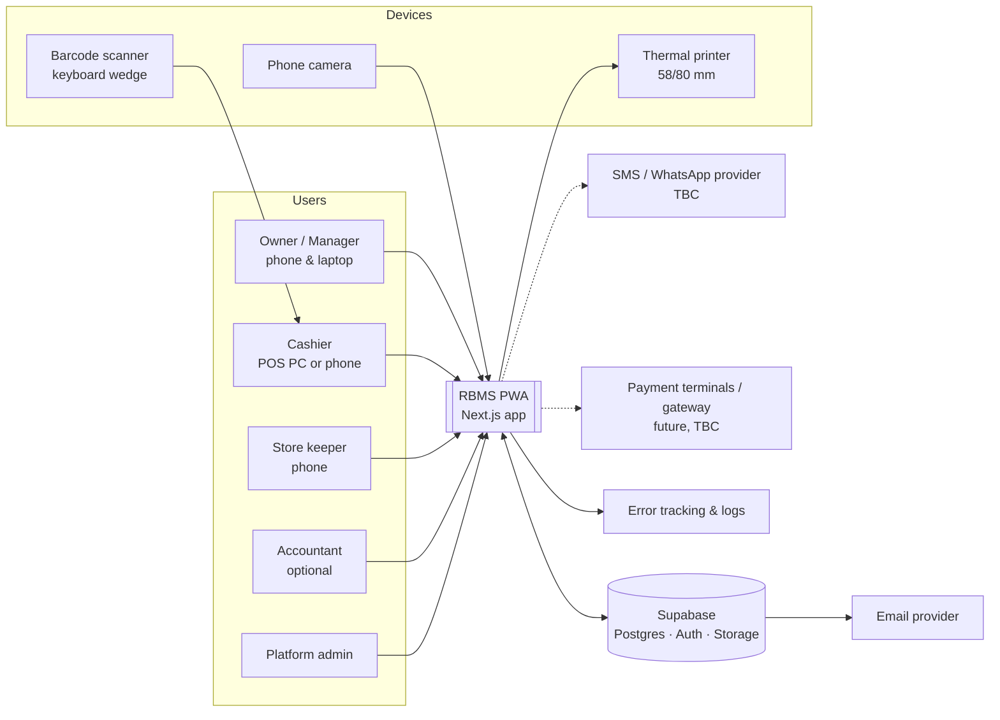
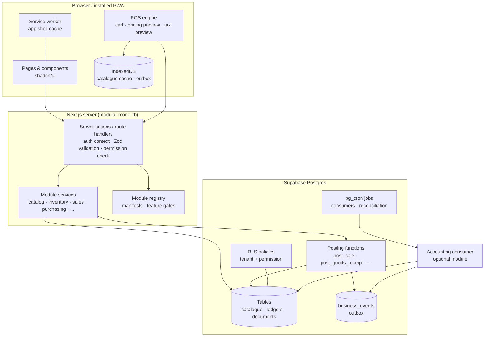
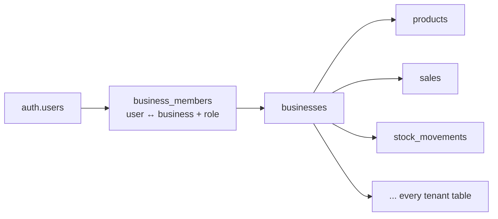
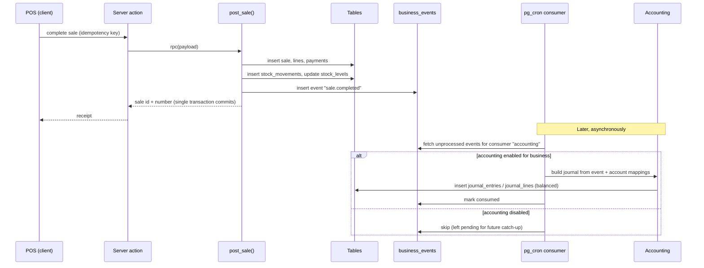
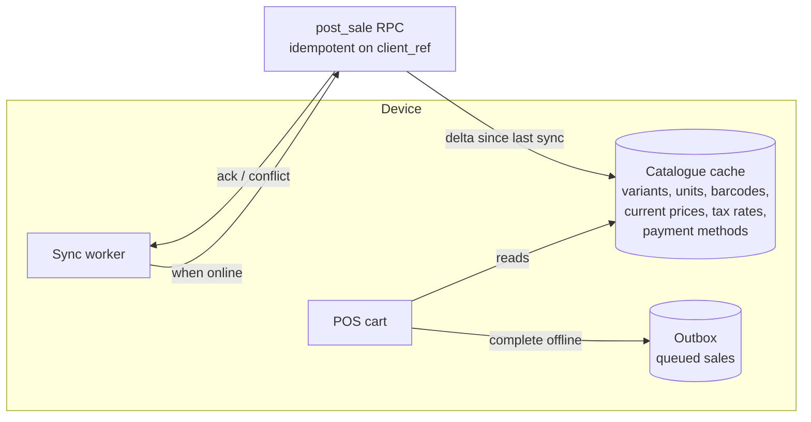
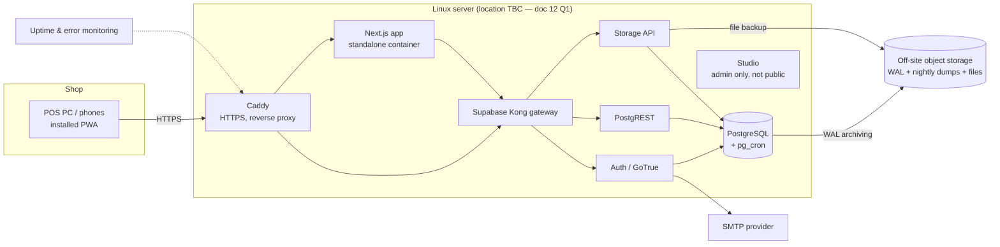

# 04 — System Architecture

Status: Draft v0.1 · 6 November 2026

Decisions marked **ADR-nnn** are listed with alternatives in `11-open-questions-risks-decisions.md §3` and need approval before implementation.

---

## 1. Architectural drivers

| Driver | Consequence for the design |
|---|---|
| Real business use (money and stock) | Atomic database postings, append-only ledgers, idempotent writes, tested restores. |
| Multiple isolated businesses | Tenant key on every row + PostgreSQL RLS as the enforcement layer. |
| Five very different product families, and future retailers | Generic catalogue: categories + typed attributes + variants + per-product units. |
| Optional accounting that must not interfere | Event outbox: operations publish events; accounting consumes asynchronously. No dependency from operations to accounting. |
| Mobile + desktop, unreliable connectivity and power | PWA, mobile-first UI, cached catalogue, and (if approved) offline sale queue. |
| Small team, preferred stack | Next.js + Supabase "modular monolith"; no microservices. |

## 2. System context



## 3. Technology stack

| Layer | Choice | Notes |
|---|---|---|
| UI framework | Next.js (App Router), React, TypeScript (strict) | Confirmed preference. Server Components for back-office pages; Client Components for POS. |
| Styling / components | Tailwind CSS, shadcn/ui (Radix primitives) | Confirmed preference. Design tokens for light/dark/high-contrast. |
| Forms & validation | React Hook Form + Zod | Same Zod schemas validate on client and server. [Proposed] |
| Client data | TanStack Query for server state; IndexedDB (via Dexie) for offline cache and outbox | [Proposed] |
| PWA | Web app manifest + service worker (e.g. Serwist) | Library choice confirmed in a Phase 0 spike. |
| Decimal maths | decimal.js (or big.js) | No JS floats for money/quantity (NFR-INT-002). |
| Barcode (camera) | Browser BarcodeDetector where available, fallback library (e.g. ZXing) | Spike in Phase 0. |
| Backend | Next.js Server Actions / Route Handlers (Node runtime) | Thin orchestration + validation layer. |
| Database | Supabase PostgreSQL | RLS, Postgres functions for postings, `pg_cron` for scheduled jobs. |
| Auth | Supabase Auth | Email/password; phone OTP TBC (Q-U03). |
| Files | Supabase Storage | Product images, expense receipts, logos; business-scoped paths. |
| Background work | Postgres functions on `pg_cron` (verify extension in the self-hosted Postgres image) | Event consumers (accounting), reconciliation, notifications. |
| Hosting | **Self-hosted**: Docker Compose on a Linux server — Supabase stack, Next.js standalone, Caddy reverse proxy | ADR-009 decided; see §16. |
| Observability | Sentry (or similar) + structured logs | |
| Testing | Vitest, pgTAP, Playwright | |
| CI/CD | GitHub Actions: lint, type-check, tests, migrations to staging, manual promote to prod | |

## 4. Logical architecture



### 4.1 Where business logic lives (ADR-002)

| Kind of logic | Location | Why |
|---|---|---|
| **Invariants that protect money and stock** (atomic posting, stock level update, average cost, document numbering, journal balance) | PostgreSQL functions (`SECURITY DEFINER`, fixed `search_path`), called via RPC from server code | One transaction, row locks, impossible to bypass from any client, same rules for online and offline-synced sales. |
| **Orchestration, validation, permissions UX** | Next.js server actions in each module | Readable TypeScript, shared Zod schemas, good error messages. |
| **Previews** (cart totals, price lookup, unit conversion while typing) | Client POS engine, shared pure TS library | Instant feedback offline. Server recomputes on posting (NFR-INT-008). |
| **Read models / reports** | SQL views and functions, materialised where heavy | Close to data, efficient. |

Rule: **the browser never writes to ledger tables directly.** It calls a server action, which calls a posting function.

## 5. Multi-tenancy (ADR-001)

**Model:** single database, shared schema, `business_id` on every tenant-owned table.



Enforcement layers:

1. **RLS on every tenant table.** Policies use helper functions:
   - `app.is_member(business_id)` — active membership of the current user (`auth.uid()`).
   - `app.has_permission(business_id, 'module.resource.action')`.
   - `app.can_access_location(business_id, location_id)` — for location-bound rows.
   - `app.module_enabled(business_id, 'accounting')` — for optional-module tables.
2. **Composite foreign keys** `(business_id, parent_id) → parent(business_id, id)` so a row can never reference another tenant's row, even through a bug.
3. **Posting functions** re-check membership, permission, module status and that all referenced IDs belong to the same business.
4. **Storage** paths begin with `business_id/` and storage policies apply the same membership check.
5. **Automated cross-tenant tests** (NFR-SEC-001).

**Active business context:** the user picks a business; its ID is kept in a signed, HTTP-only cookie and passed explicitly to every query and RPC. RLS does not rely on the cookie — it relies on membership — so a tampered cookie cannot grant access.

**Why not schema-per-tenant or database-per-tenant now:** much higher migration and operating cost for many small tenants; Supabase tooling assumes a shared schema. The design keeps `business_id` everywhere so a very large tenant can later be moved to its own database.

## 6. Module system

### 6.1 Module manifest (code)

Each module exports a manifest, e.g.:

```ts
// illustrative only — not implementation
export const inventoryModule = {
  code: 'inventory',
  kind: 'core',                 // core | optional
  dependsOn: ['catalog'],
  permissions: ['inventory.stock.view', 'inventory.adjustment.create', /* ... */],
  nav: [{ label: 'Inventory', href: '/inventory', permission: 'inventory.stock.view' }],
  publishes: ['stock.adjusted', 'stock.transferred', 'stock.counted'],
  subscribes: [],
};
```

### 6.2 Module state (database)

`modules` (registry) and `business_modules` (per-business enabled flag + config). Gating happens in the navigation, in server actions (`requireModule('accounting')`), and in RLS for optional-module tables.

### 6.3 Core vs optional modules

| Core (always on) | Optional (switchable) |
|---|---|
| Platform & tenancy, Identity & access, Configuration, Catalogue, Pricing & tax, Inventory, Sales/POS, Cash sessions, Customers (records), Suppliers & receiving, Reporting (operational), Audit | Purchase orders (P2), Customer credit / receivables (TBC), Supplier payables (TBC), Batches & expiry (TBC), Expenses, Accounting, Offline POS (if made optional), Notifications, Integrations |

See `07-module-dependency-map.md`.

## 7. Event outbox & optional accounting (ADR-004, ADR-005)



Guarantees:

- Operational posting **never calls** accounting code and has **no foreign keys** into accounting tables.
- If accounting posting fails (missing mapping, closed period), the event is marked *failed* with a reason; the sale is unaffected; an accountant fixes the mapping and retries.
- Events carry everything accounting needs (amounts by tax rate, cost of goods, payment method amounts), so accounting does not need to query operational tables, keeping the coupling one-way.
- Enabling accounting later: choose a start date, enter opening balances, and optionally back-post events from that date (ADR-005).

## 8. Inventory engine (ADR-006, ADR-007)

- **Ledger:** `stock_movements` (append-only, signed quantity in base units, unit cost, source reference).
- **Cache:** `stock_levels` (per location + variant: on hand, average cost) and `batch_stock_levels` when batches are tracked. Updated only inside posting functions under row locks.
- **Costing:** weighted average cost per location and variant [Proposed, ADR-006]. Sales record cost at time of sale (`unit_cost_snapshot`), which drives margin reports without accounting.
- **Unit conversion:** lines store entered unit, entered quantity, factor, and base quantity; only base quantity enters the ledger.
- **Reconciliation:** nightly job compares `stock_levels.on_hand` to `SUM(stock_movements.quantity)`; mismatch raises an alert (NFR-INT-004).
- **Negative stock:** policy per business (ADR-007 / Q-I01). Offline-synced sales are always accepted and may produce negative stock, flagged for review.

## 9. Offline-capable POS (ADR-008, depends on Q-T01)



Design rules:

- Each device is registered (`pos_devices`) and gets a receipt prefix, so offline receipts get unique numbers without contacting the server (`LOC1-D2-000123`).
- Each sale has a device-generated UUID `client_ref`; `post_sale` returns the existing sale if that ref was already posted (idempotent).
- Cached data per device is limited to its location and to non-sensitive fields (cost excluded unless permitted).
- Sync accepts the sale as recorded (the money was taken) and flags conflicts: price differs from server, stock insufficient, product archived, session closed.
- iOS Safari lacks Background Sync; sync runs when the app is open/foregrounded. Documented for users.
- Back-office functions are online-only in the first releases.

## 10. Security architecture

| Concern | Measure |
|---|---|
| Authentication | Supabase Auth; sessions in HTTP-only cookies via Supabase SSR helpers; refresh handled server-side. |
| Authorisation | Permission catalogue + roles (doc 08); `requirePermission()` in server actions; `app.has_permission()` in RLS and posting functions. |
| Sensitive actions | Manager override flow records both users (FR-IAM-009). |
| Data at rest | Supabase-managed encryption; no secrets in client storage. |
| Secrets | Environment variables per environment; service-role key server-only. |
| Least privilege | `anon` role has no table access; `authenticated` constrained by RLS; posting functions are the only writers of ledgers. |
| Input | Zod validation on every server action; parameterised SQL only. |
| Audit | `audit_logs` written by triggers on sensitive tables and by posting functions. |

## 11. Data access patterns

- **Back office:** Server Components query Supabase with the user's session (RLS applies).
- **Mutations:** Server Actions → Supabase RPC (posting functions) or direct table writes for simple master data (catalogue, settings) under RLS.
- **POS:** client loads catalogue snapshot + deltas (`updated_at > last_sync`) into IndexedDB; posts sales via a server action wrapping `post_sale`.
- **Reports:** SQL functions with parameters (business, location, date range, time zone).
- **Realtime (optional):** Supabase Realtime for dashboard refresh — not required for MVP.

## 12. Proposed repository structure

```
/app
  /(auth)/sign-in, /invite/[token]
  /(app)/[businessSlug]/
      dashboard/ pos/ sales/ catalog/ inventory/ purchasing/
      customers/ suppliers/ reports/ settings/
      expenses/ accounting/        ← rendered only if module enabled
  /platform/                       ← platform-admin area
/modules
  /core-tenancy  /iam  /config  /catalog  /pricing  /inventory
  /purchasing  /sales  /cash  /customers  /reporting  /audit
  /expenses  /accounting  /offline
     each: manifest.ts, actions/, components/, queries/, schemas/, events/
/lib
  /supabase (server & browser clients) /decimal /money /units /i18n /permissions
/supabase
  /migrations   /seed   /tests (pgTAP)
/docs
  /adr
```

Import boundaries enforced by ESLint (e.g. `eslint-plugin-boundaries`): core modules cannot import `expenses` or `accounting`.

## 13. Environments & delivery

| Environment | Purpose |
|---|---|
| Local | Supabase CLI (Docker), seeded demo business. |
| Staging | Separate Supabase project; anonymised or synthetic data; pilot UAT. |
| Production | Separate Supabase project; PITR enabled; restricted access. |

Pipeline: PR → lint/type-check/unit/pgTAP/e2e → merge → migrate staging → manual approval → migrate production → deploy app. Migrations must be backward-compatible with the previous app version (expand → migrate → contract) because installed PWAs may run an older version for a while; the app checks its version against the server and prompts to refresh.

## 14. Hosting region and latency

The Supabase region should be chosen for latency to Nigeria and for data-protection requirements (Q-L02). Measure round-trip latency from the pilot location to candidate regions during Phase 0; offline caching on the POS reduces sensitivity to latency for lookups.

## 15. Extensibility for other retail types

| Mechanism | Example |
|---|---|
| Business templates (seed bundles) | "Fashion boutique": categories, Size/Colour axes, units piece; "Mini-mart": categories, units piece/pack/carton, batch tracking on. |
| Configurable attributes & variant axes | Electronics: Storage, Colour, IMEI (future: serial tracking). |
| Settings | Negative stock, tax-inclusive pricing, rounding, required customer. |
| Optional modules | Expenses, Accounting, Purchase orders, Credit sales. |
| New modules (code) | Serial numbers, tailoring orders, e-commerce sync, loyalty — plug into the manifest, permission catalogue and event bus without changing core tables. |

## 16. Self-hosted deployment (ADR-009, decided 6 Nov 2026)



| Concern | Approach |
|---|---|
| Environments | Separate staging and production stacks (separate servers or at least separate Compose projects and databases). Local development uses the Supabase CLI. |
| Secrets | `.env` per environment outside source control; JWT secret, service-role key, Postgres password rotated from Supabase defaults before first start. |
| Network exposure | Only ports 80/443 public. Postgres, Studio and Kong admin bound to localhost/VPN. SSH by key only. Firewall on. |
| Updates | Automated OS security updates; Supabase image versions pinned and upgraded deliberately in staging first. |
| Backups | Continuous WAL archiving + nightly base backup (pgBackRest or WAL-G) to off-site storage; storage-bucket sync; retention 30 days (proposed); quarterly restore drill. |
| Migrations | Same versioned SQL migrations, applied by CI over SSH (or a deploy step) to staging, then production after approval. |
| Monitoring | External uptime check, disk/CPU alerts, backup-success check, error tracking for app. |
| Sizing (single shop) | Start with 2 vCPU / 4 GB RAM / 80 GB SSD; review after pilot. [Proposed] |
| If the server is in the shop | UPS for server and router; secure tunnel for remote/owner access and valid HTTPS; off-site backups are mandatory. |
