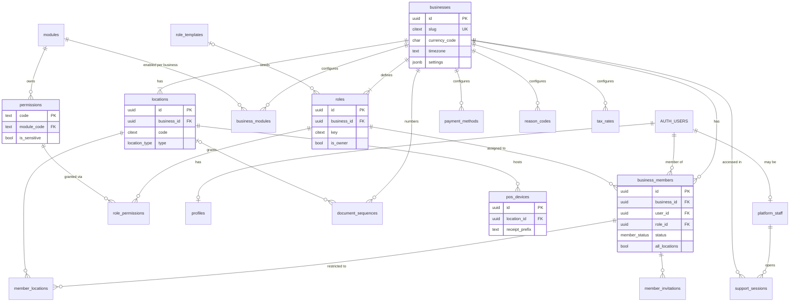
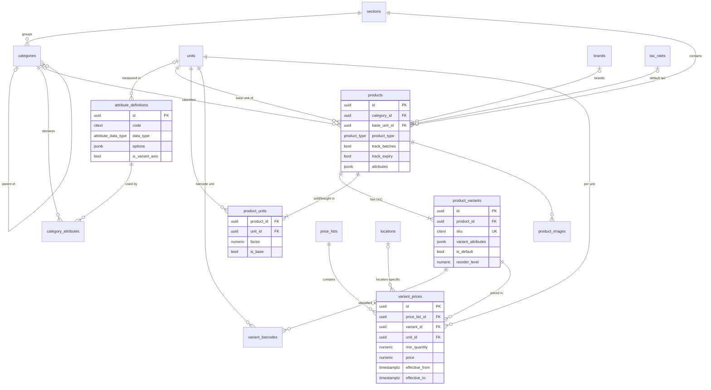
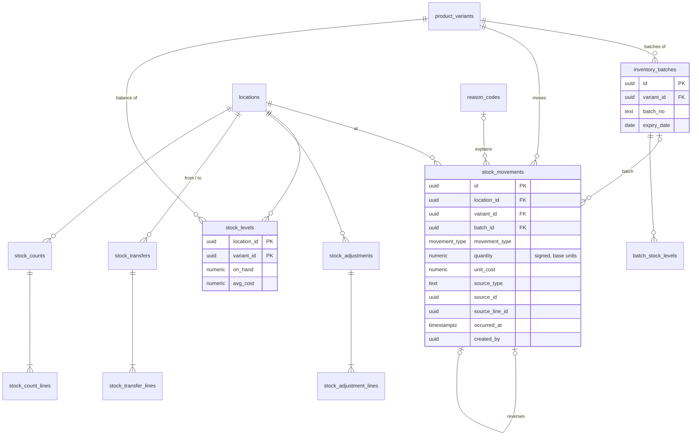
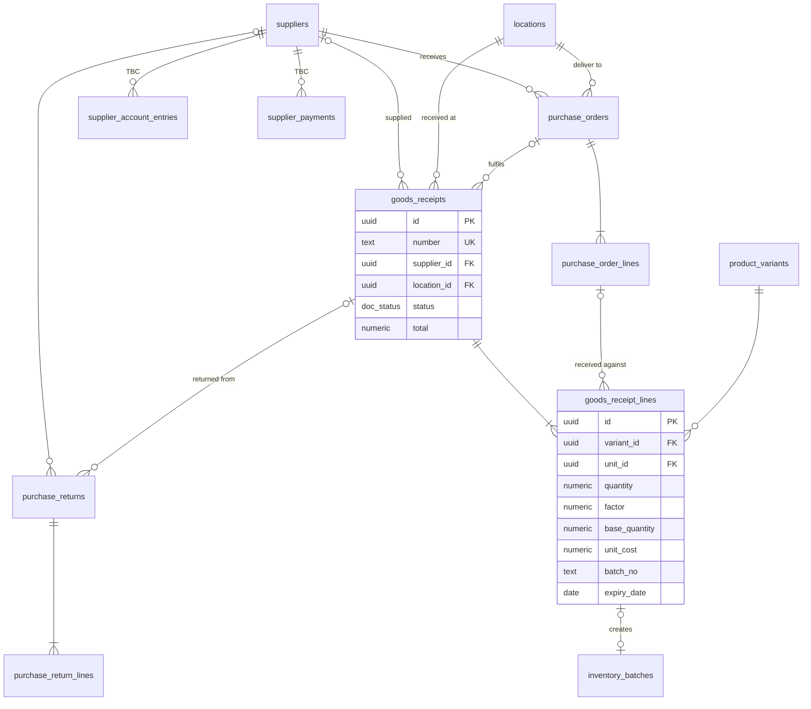
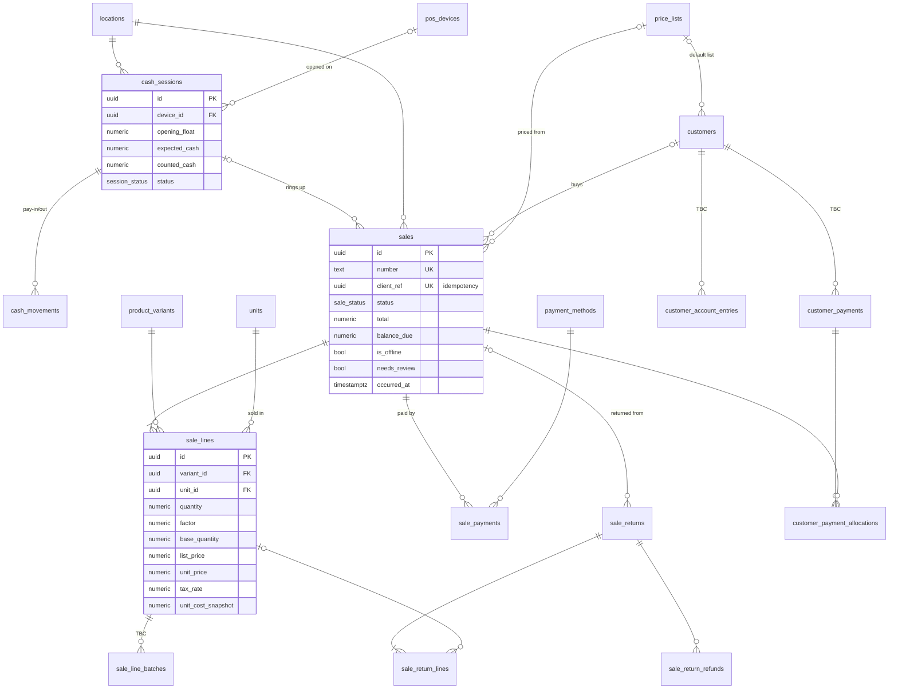
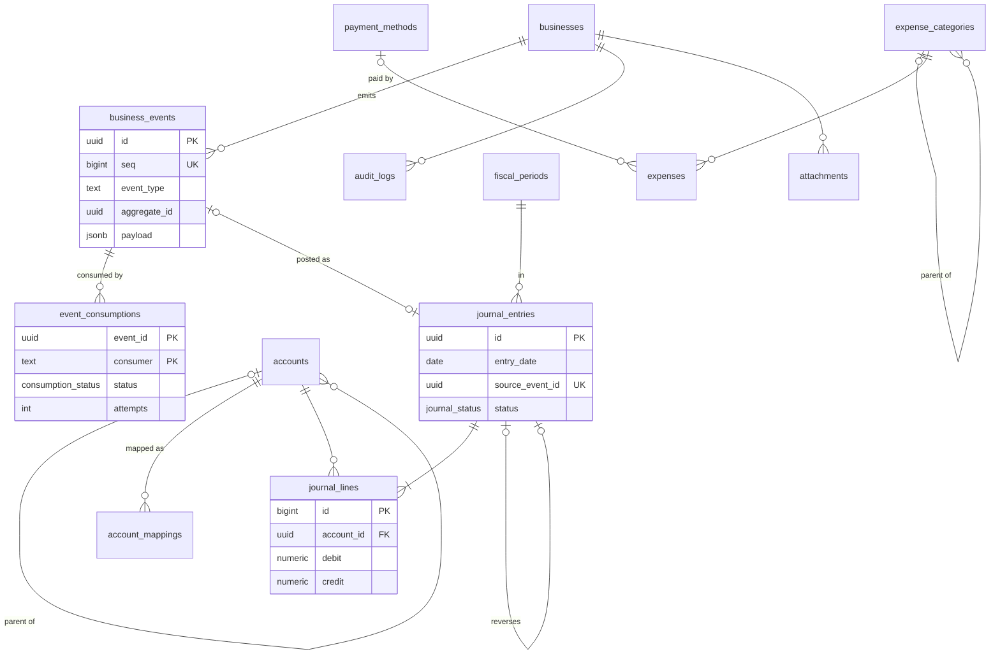

# 05 — Entity Relationship Diagram

Status: Draft v0.1 · 6 November 2026

The model is split into six diagrams for readability. Full column definitions are in `06-database-schema.md`. Diagrams use Mermaid (`erDiagram`) and render on GitHub and most Markdown viewers.

**Not drawn, but true for every tenant table:** a `business_id` column referencing `businesses`, and composite foreign keys `(business_id, parent_id)` so rows can only reference rows in the same business.

Notation: `||--o{` one-to-many (optional many) · `||--|{` one-to-many (at least one) · `|o--o{` optional parent.

---

## 1. Tenancy, identity & configuration

## 2. Catalogue & pricing

## 3. Inventory

`stock_movements.source_type/source_id` is a polymorphic reference to the originating document (sale, return, goods receipt, transfer, adjustment, count). It is not a database FK by design, because the ledger must accept movements from documents in any module.

## 4. Purchasing & suppliers

## 5. Sales, cash, customers & returns

## 6. Optional modules, events & audit

**Dependency direction:** accounting and expenses tables reference core tables (e.g. `payment_methods`, `business_events`); **no core table references an accounting or expenses table** (the only link, `cash_movements.expense_id`, is deliberately a plain column without FK). This keeps the optional modules removable.
