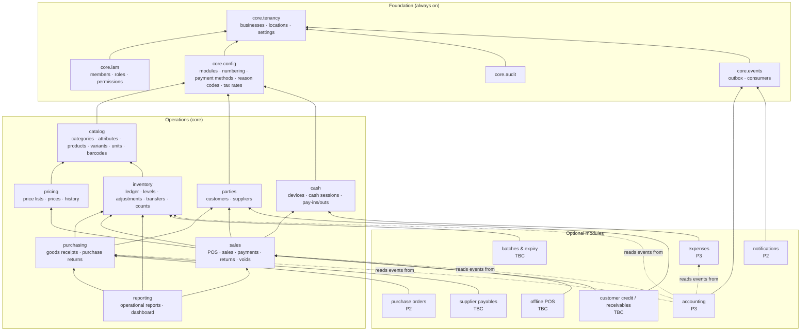
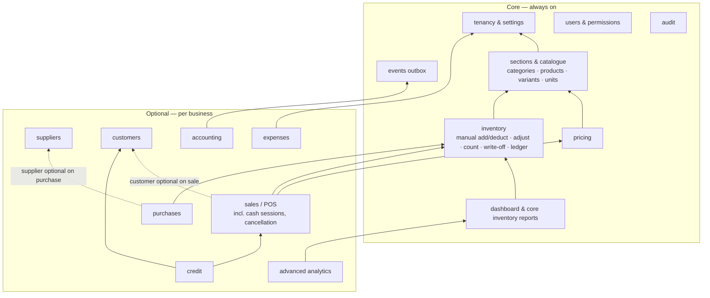

# 07 — Module Dependency Map

Status: Draft v0.1 · 6 November 2026

> **v0.3:** §6 supersedes the graph and register in §2–§3 (sales, purchasing, suppliers, customers and credit are now optional modules).

## 1. Rules

1. Dependencies form a **directed acyclic graph**. A module may depend only on modules below it in the graph.
2. A module **writes only its own tables**. It may read other modules' tables through their published queries/views, and change other modules' state only by calling their published services (e.g. Sales calls Inventory's `apply_stock_movement` through `post_sale`).
3. **No core module depends on an optional module.** In particular nothing in Sales, Purchasing, Inventory or Cash imports from Expenses or Accounting (enforced by lint rules — NFR-MNT-002).
4. Optional modules integrate by **subscribing to business events** or by **extending the UI through registered slots** (e.g. Expenses adds a "Record as expense" action to a cash pay-out), never by being called from core code.
5. Enabling a module requires its dependencies to be enabled; disabling is blocked while a dependent module is enabled (FR-CFG-002).

## 2. Dependency graph

Solid arrow = "depends on". Dotted arrow = "consumes events published by" (a runtime data flow, not a code dependency; accounting works with whichever event publishers are enabled).

All modules implicitly depend on Foundation (IAM for permissions, AUD for audit logging, EVT for publishing); those arrows are omitted for readability.

## 3. Module register

| Module | Kind | Depends on | Publishes events | Consumes events | Phase |
|---|---|---|---|---|---|
| core.tenancy | Core | — | `business.created`, `location.created` | — | 0 |
| core.iam | Core | tenancy | `member.invited`, `member.role_changed` | — | 0 |
| core.config | Core | tenancy | `module.enabled`, `module.disabled`, `settings.changed` | — | 0 |
| core.audit | Core | tenancy | — | — (written synchronously) | 0 |
| core.events | Core | tenancy | — | dispatches to consumers | 0 |
| catalog | Core | config | `product.created`, `product.updated`, `variant.archived` | — | 1 |
| pricing | Core | catalog | `price.changed` | — | 1 |
| inventory | Core | catalog | `stock.adjusted`, `stock.transferred`, `stock.counted`, `stock.went_negative` | — | 1 |
| parties | Core | config | `customer.created`, `supplier.created` | — | 1 |
| purchasing | Core | inventory, parties | `goods_receipt.posted`, `purchase_return.posted` | — | 1 |
| cash | Core | config | `cash_session.opened`, `cash_session.closed`, `cash.paid_out` | — | 1 |
| sales | Core | pricing, inventory, cash, parties | `sale.completed`, `sale.voided`, `sale.returned` | — | 1 |
| reporting | Core | sales, purchasing, inventory | — | — | 1 |
| batches | Optional | inventory | `batch.expiring` | — | TBC (Q-C02) |
| purchase_orders | Optional | purchasing | `purchase_order.sent` | — | 2 |
| receivables | Optional | sales, parties | `customer_payment.received` | `sale.completed` (credit part) | TBC (Q-F01) |
| payables | Optional | purchasing | `supplier_payment.made` | `goods_receipt.posted` | TBC (Q-F02) |
| offline_pos | Optional* | sales | — | — | TBC (Q-T01) |
| expenses | Optional | cash | `expense.posted` | `cash.paid_out` (offer to classify) | 3 |
| accounting | Optional | events | `journal.posted` | all financial events above | 3 |
| notifications | Optional | events | — | `stock.went_negative`, `batch.expiring`, `cash_session.closed`, … | 2 |

\* Offline POS may be better treated as always-on for the pilot, depending on Q-T01.

## 4. How "accounting disabled" stays harmless — checklist

| Concern | Mechanism |
|---|---|
| Code dependency | Core modules never import accounting; lint boundary rule fails the build otherwise. |
| Data dependency | No FK from core tables to accounting tables. |
| Transaction coupling | Sales/purchasing/inventory postings write events in the same transaction; accounting processes them later, in a different transaction. |
| Failure isolation | A failing accounting consumer marks the event `failed`; operational transactions are already committed. |
| Validation coupling | No operational form requires an account code. Mapping errors surface only in accounting screens. |
| Performance | Consumer runs on a schedule in batches; it does not lock operational rows. |
| Testing | Operational e2e and pgTAP suites run in CI with accounting on and off (NFR-TST-004). |
| UX | Accounting menus, permissions and settings are hidden when disabled; historic accounting data remains readable by permitted users. |

## 5. Build order implied by the graph

`core.*` → `catalog` → `pricing` & `inventory` & `parties` → `cash` → `purchasing` → `sales` → `reporting` → optional modules (in roadmap order).

## 6. v0.3 module map (supersedes §2–§3)

| Module | Requires | Pilot |
|---|---|---|
| Sales / POS | pricing, inventory | **On** |
| Purchases | inventory (suppliers optional) | **On** |
| Suppliers | — | **On** |
| Customers | — | **On** |
| Credit | sales **and** customers | **On** |
| Expenses | — | Off |
| Accounting | events (uses sales/purchases/expenses data when present) | Off |
| Advanced analytics | dashboard | Off |

Disabling: navigation hidden; server actions and RLS writes blocked; data kept read-only for permitted users; re-enabling restores access. Disabling Sales or Customers is refused while Credit is on.
