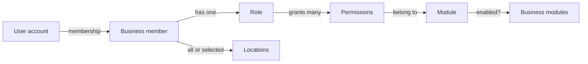
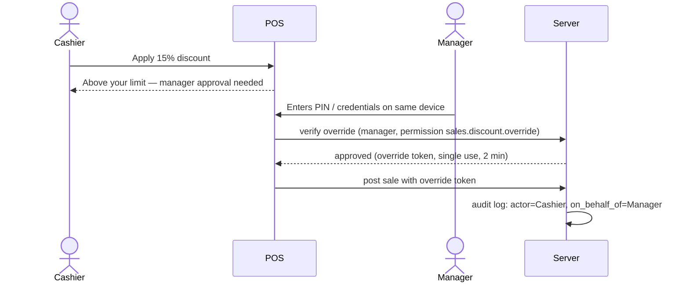

# 08 — User Roles and Permission Definitions

Status: v0.3 · 6 November 2026

> **v0.3:** the default staff role is **Attendant** (POS + stock receiving/counting, no cost prices, no price changes). Owner can edit permissions per role. Cancellation (`sales.sale.cancel`) is **Owner-only, same day**. Discounts and price overrides are off for the pilot. Section-level filters apply to all inventory screens.

> **MVP note (doc 12):** permissions `sales.sale.void`, `sales.return.*`, `sales.price.override`, `inventory.transfer.*` and the tax settings are **inactive** in MVP (features out of scope). `sales.credit.sell` and `receivables.payment.record` are **active**. Discount permissions depend on doc 12 Q2.

The pilot's actual staff structure is not yet known (Q-B01). The roles below are **proposed default templates**; each business gets editable copies and may create custom roles (custom-role UI in P2).

---

## 1. Access model

A user can perform an action in a business when **all** are true:

1. The user has an **active membership** in that business.
2. The member's **role grants the permission** (`module.resource.action`).
3. The permission's **module is enabled** for the business.
4. For location-bound actions, the member **can access that location**.
5. For **sensitive** actions above configured limits, an **approval or manager override** is supplied (FR-IAM-009).

Two scopes exist:

| Scope | Who | Where defined |
|---|---|---|
| Platform | Our own staff: `platform_admin`, `support` | `platform_staff` table; separate `/platform` area |
| Business | Members of one business | `roles`, `role_permissions`, `business_members` |

Platform staff have **no implicit access** to tenant data. Support uses time-limited, audited support sessions (FR-PLT-009).

## 2. Default business role templates

| Role | Purpose | Location scope (default) |
|---|---|---|
| **Owner** | Full control of the business, billing, users, modules. Cannot be removed by others; at least one active Owner required. | All |
| **Manager** | Runs one or more shops day to day: prices, stock, receiving, approvals, cash-up, reports. No module/billing control. | Assigned |
| **Cashier** | Sells, takes payments, opens/closes own till, simple returns within limits. | Assigned |
| **Inventory officer** | Receives goods, transfers, counts, records damage/expiry; no selling. | Assigned |
| **Accountant** *(only when Expenses/Accounting enabled)* | Expenses, chart of accounts, journals, financial reports, cost visibility. Read-only on operations. | All |
| **Viewer / Auditor** | Read-only access to reports and documents; no cost prices unless granted. | All or assigned |

## 3. Permission catalogue

Format `module.resource.action`. ★ = **sensitive** (audited; may require approval/override above thresholds).

### Core / administration
| Permission | Description |
|---|---|
| `core.business.update` ★ | Edit business profile and settings |
| `core.location.manage` | Create/edit/deactivate locations |
| `core.module.manage` ★ | Enable/disable modules |
| `core.member.view` | View members |
| `core.member.invite` ★ | Invite members, assign roles/locations |
| `core.member.suspend` ★ | Suspend/remove members |
| `core.role.manage` ★ | Create/edit roles and permissions |
| `core.config.manage` | Payment methods, reason codes, numbering, tax rates |
| `core.audit.view` | View audit log |
| `core.device.manage` | Register/deactivate POS devices |
| `core.import.run` ★ | Run data imports |

### Catalogue & pricing
| Permission | Description |
|---|---|
| `catalog.product.view` | View products (no cost) |
| `catalog.product.create` | Create products/variants |
| `catalog.product.update` | Edit products/variants |
| `catalog.product.archive` | Archive products |
| `catalog.structure.manage` | Categories, attributes, units, brands |
| `pricing.price.view` | View prices and price history |
| `pricing.price.update` ★ | Change prices (incl. bulk updates) |
| `pricing.pricelist.manage` | Create/edit price lists |
| `inventory.cost.view` ★ | See cost prices, average cost, margins, valuation |

### Inventory
| Permission | Description |
|---|---|
| `inventory.stock.view` | View stock levels and stock cards |
| `inventory.adjustment.create` | Draft adjustments/damage/expiry |
| `inventory.adjustment.post` ★ | Post adjustments |
| `inventory.adjustment.approve` ★ | Approve adjustments above threshold |
| `inventory.transfer.create` | Create/dispatch transfers |
| `inventory.transfer.receive` | Receive transfers |
| `inventory.count.perform` | Enter counts |
| `inventory.count.post` ★ | Review and post stock counts |
| `inventory.negative.review` | Review negative-stock and sync-conflict flags |

### Purchasing & suppliers
| Permission | Description |
|---|---|
| `parties.supplier.manage` | Create/edit suppliers |
| `purchasing.receipt.create` | Draft goods receipts |
| `purchasing.receipt.post` | Post goods receipts |
| `purchasing.return.post` ★ | Post purchase returns |
| `purchasing.po.manage` | Purchase orders (P2) |
| `payables.payment.record` ★ | Record supplier payments (TBC) |

### Sales, cash & customers
| Permission | Description |
|---|---|
| `sales.pos.use` | Use the POS, create sales |
| `sales.sale.view_own` | View own sales |
| `sales.sale.view_all` | View all sales in accessible locations |
| `sales.discount.apply` | Apply discounts up to configured limit |
| `sales.discount.override` ★ | Approve discounts above limit |
| `sales.price.override` ★ | Change price at POS |
| `sales.sale.void` ★ | Void a completed sale |
| `sales.return.create` | Process returns within limit |
| `sales.return.approve` ★ | Approve returns/refunds above limit or without receipt |
| `sales.credit.sell` ★ | Sell on credit (TBC) |
| `cash.session.operate` | Open/close own cash session, pay-ins/outs within limit |
| `cash.session.manage` ★ | Close others' sessions, reconcile, view variances |
| `cash.payout.approve` ★ | Approve pay-outs above limit |
| `parties.customer.view` | View customers |
| `parties.customer.manage` | Create/edit customers |
| `receivables.payment.record` | Record customer payments (TBC) |
| `parties.customer.erase` ★ | Anonymise a customer (data-protection request) |

### Reporting
| Permission | Description |
|---|---|
| `reports.sales.view` | Sales reports |
| `reports.inventory.view` | Stock reports (values need `inventory.cost.view`) |
| `reports.cash.view` | Cash session reports |
| `reports.export` | Export to CSV/PDF |

### Expenses (optional)
| Permission | Description |
|---|---|
| `expenses.expense.create` | Record expenses |
| `expenses.expense.approve` ★ | Approve expenses above threshold |
| `expenses.category.manage` | Manage expense categories |
| `expenses.report.view` | Expense and simple profit reports |

### Accounting (optional)
| Permission | Description |
|---|---|
| `accounting.coa.manage` ★ | Chart of accounts and mappings |
| `accounting.journal.view` | View journals and ledgers |
| `accounting.journal.create` ★ | Manual journals |
| `accounting.period.manage` ★ | Open/close/lock periods |
| `accounting.events.manage` | Retry/skip failed event postings |
| `accounting.report.view` | Trial balance, P&L, balance sheet |

## 4. Default permission matrix

✓ = granted · L = granted with limit (threshold-controlled; above it needs override) · — = not granted · (opt) = only when module enabled

| Permission group | Owner | Manager | Cashier | Inventory officer | Accountant (opt) | Viewer |
|---|:-:|:-:|:-:|:-:|:-:|:-:|
| Business settings, modules, roles | ✓ | — | — | — | — | — |
| Invite / suspend members | ✓ | L¹ | — | — | — | — |
| Payment methods, reason codes, tax, numbering | ✓ | ✓ | — | — | ✓ (tax) | — |
| POS devices | ✓ | ✓ | — | — | — | — |
| Audit log | ✓ | ✓ (own locations) | — | — | ✓ | ✓ |
| Catalogue view | ✓ | ✓ | ✓ | ✓ | ✓ | ✓ |
| Catalogue create/edit/structure | ✓ | ✓ | — | ✓ (create/edit only) | — | — |
| Price change / price lists | ✓ | ✓ | — | — | — | — |
| **Cost prices & margins** | ✓ | ✓ | — | — | ✓ | — |
| Stock view | ✓ | ✓ | ✓ (qty only) | ✓ | ✓ | ✓ |
| Adjustments: create / post / approve | ✓/✓/✓ | ✓/L/✓ | — | ✓/L/— | — | — |
| Transfers: create / receive | ✓ | ✓ | — | ✓ | — | — |
| Counts: perform / post | ✓ | ✓/✓ | ✓/— | ✓/— | — | — |
| Suppliers, goods receipts | ✓ | ✓ | — | ✓ | view | view |
| Purchase returns | ✓ | ✓ | — | L | — | — |
| POS / sell | ✓ | ✓ | ✓ | — | — | — |
| Discounts | ✓ | ✓ (override) | L | — | — | — |
| Price override at POS | ✓ | ✓ | — | — | — | — |
| Void sale | ✓ | ✓ | — | — | — | — |
| Returns / refunds | ✓ | ✓ (approve) | L | — | — | — |
| Credit sales (TBC) | ✓ | ✓ | — | — | — | — |
| Cash session: own | ✓ | ✓ | ✓ | — | — | — |
| Cash session: manage / reconcile | ✓ | ✓ | — | — | ✓ (view) | — |
| Pay-outs | ✓ | ✓ | L | — | — | — |
| Customers view / manage | ✓ | ✓ | ✓ / quick-add | — | view | view |
| Customer erasure | ✓ | — | — | — | — | — |
| Reports: sales / inventory / cash | ✓ | ✓ | own sales only | inventory | ✓ | ✓ |
| Export | ✓ | ✓ | — | — | ✓ | ✓ |
| Expenses (opt) | ✓ | create, L approve | — | — | ✓ | view |
| Accounting (opt) | ✓ | view reports | — | — | ✓ | view reports |

¹ Managers may invite Cashier and Inventory officer roles only, for their own locations. [Proposed]

## 5. Thresholds and approvals (values TBC)

These limits are configuration, not code. **Values must come from the owner** (Q-S04, Q-I03, Q-S03).

| Control | Setting | Proposed default until confirmed |
|---|---|---|
| Max discount without override | % of line or cart | 0% (all discounts need Manager) |
| Price override | permission only | Manager/Owner |
| Void window | same session / same day / never | Same open session |
| Return without approval | value limit | 0 (all returns approved) |
| Return without receipt | allowed? | Not allowed |
| Adjustment needing approval | value at cost | Any negative adjustment |
| Pay-out without approval | amount | 0 |
| Cash variance alert | amount | any non-zero |

## 6. Manager override flow

Quick PIN entry depends on Q-U02; without PINs, the manager signs in on a modal with email/password.

## 7. Location scoping rules

- `all_locations = true` → access to every current and future location.
- Otherwise, access only to listed locations for location-bound data: sales, cash sessions, stock levels, movements, adjustments, transfers (either end), counts, goods receipts.
- Business-wide data (catalogue, prices without location, customers, suppliers) is visible to all members with the relevant permission.
- Reports filter to accessible locations automatically.

## 8. Rules that protect the business

1. At least one active Owner must exist; the last Owner cannot be demoted or removed.
2. Users cannot grant permissions they do not have.
3. A user cannot approve their own request where approval is required (four-eyes), unless they are the Owner and the business setting allows self-approval for Owners [Proposed; Q-B01 — small shops may have only one senior person].
4. Role and permission changes take effect on the next request (permissions are checked server-side and in the database, not cached in tokens).
5. Cost visibility (`inventory.cost.view`) also controls what the offline POS cache contains.
