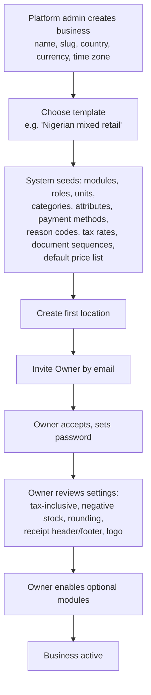
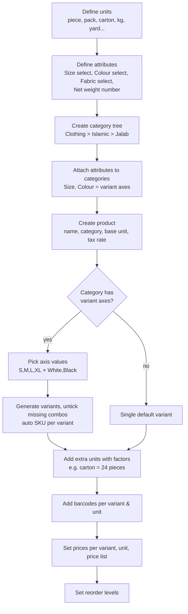
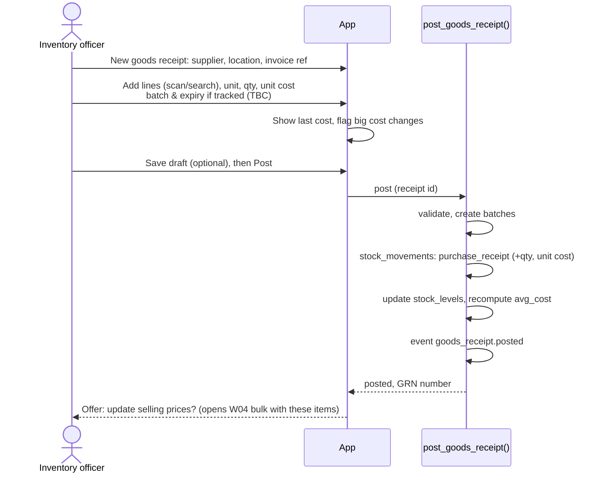
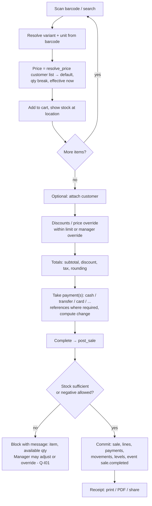
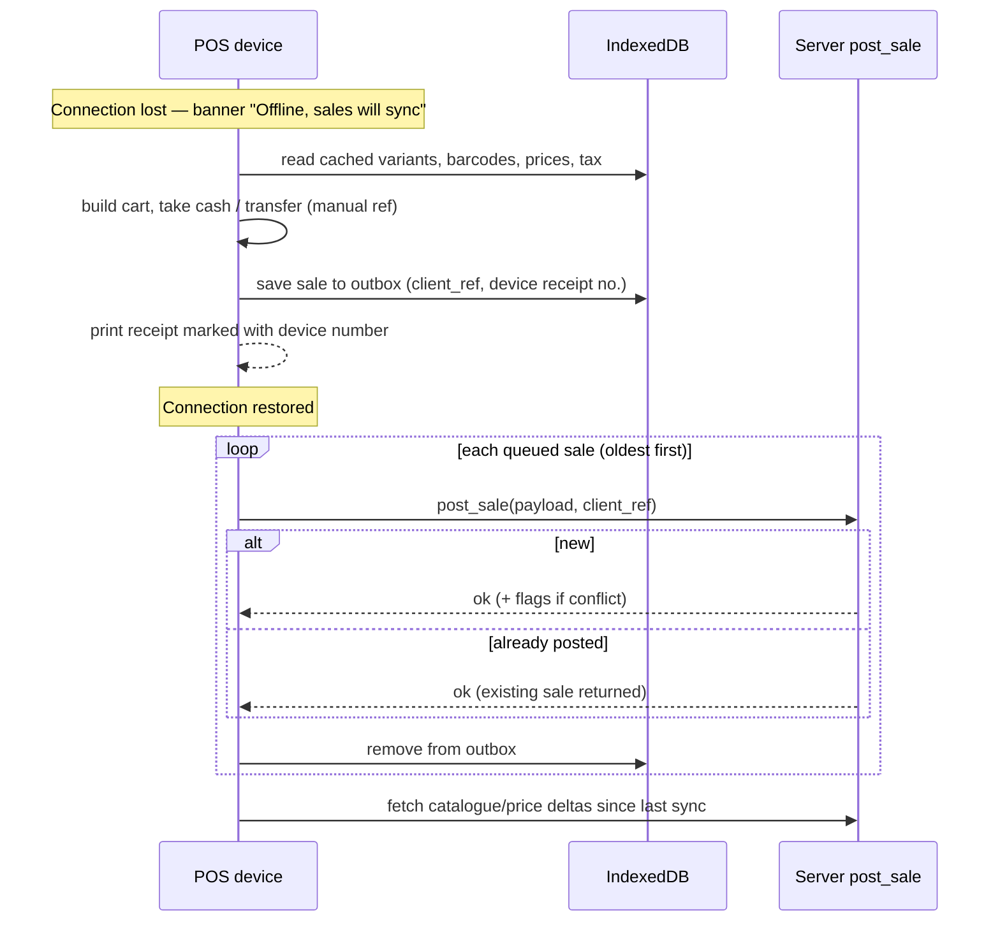
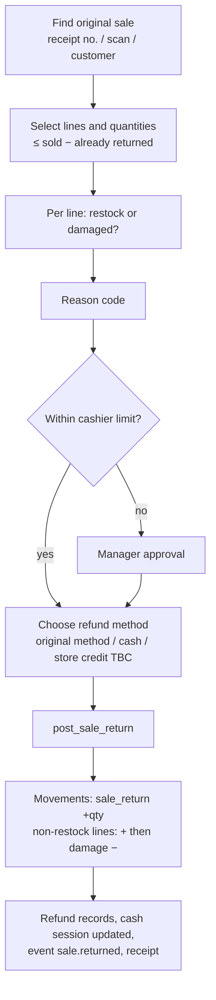
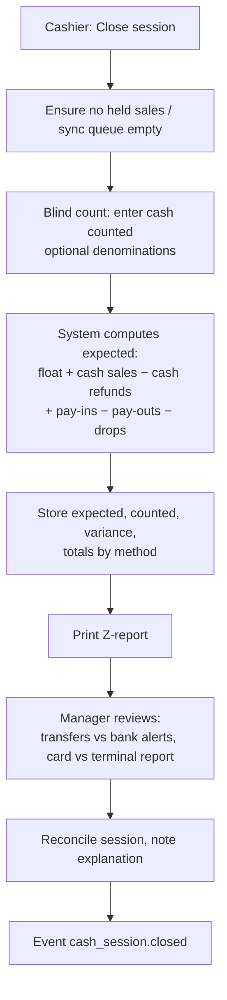
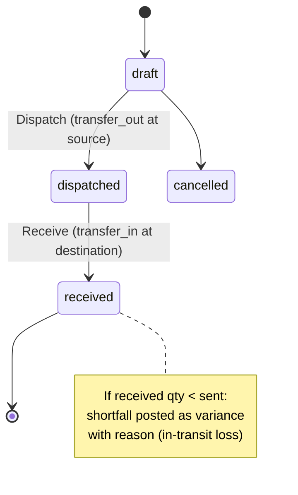
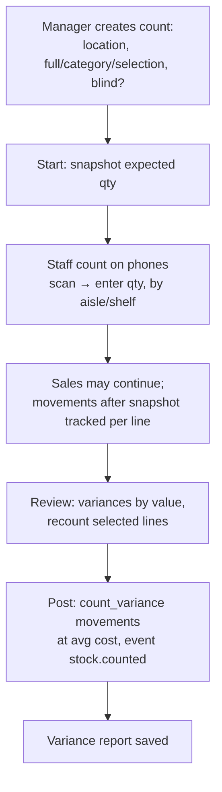
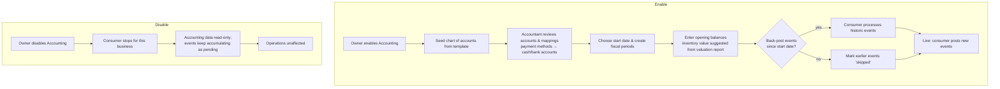

# 09 — Business Workflows

Status: v0.2 · 6 November 2026 — scope column updated from the owner's answers (doc 12). Out-of-scope workflows are kept below for future reference.

Each workflow lists actors, trigger, steps, system effects (records written, stock movements, events) and exceptions. Steps marked **(TBC)** depend on open questions and are drawn to show where they would fit, not as decisions.

| # | Workflow | Phase |
|---|---|---|
| W01 | Onboard a new business | MVP |
| W02 | Invite a staff member | MVP |
| W03 | Set up catalogue (category → attributes → product → variants → units → prices) | MVP |
| W04 | Change prices (single & bulk) | MVP |
| W05 | Receive goods from a supplier | MVP |
| W06 | Open a cash session | MVP |
| W07 | POS sale (online) | MVP |
| W08 | POS sale while offline and sync | TBC (doc 12 Q1) |
| W09 | Hold and resume a sale | MVP |
| W10 | Void a sale | **Out** (no voids — doc 12 Q3) |
| W11 | Customer return and refund | **Out** (no returns) |
| W12 | Close cash session and end-of-day | MVP |
| W13 | Stock adjustment / damage / expiry write-off | MVP |
| W14 | Transfer stock between locations | Later (one shop) |
| W15 | Stock count (stocktake) | MVP |
| W16 | Return goods to supplier | MVP |
| W17 | Credit sale and customer payment | **MVP** |
| W18 | Record an expense | P3 |
| W19 | Enable / disable accounting | P3 |
| W20 | First-time setup (no existing data) | MVP |

---

## W01 — Onboard a new business

**Actors:** Platform admin, Owner · **Trigger:** new customer signed (pilot: done by us)

**System effects:** `businesses`, `locations`, `roles`/`role_permissions` (copied from templates), `business_modules`, seed data rows, `business_members` (invited → active), audit entries, event `business.created`.

**Exceptions:** slug taken → choose another; invitation expired → resend.

## W02 — Invite a staff member

1. Owner/Manager opens *Team → Invite*; enters name, email (phone TBC), role, locations.
2. System checks the inviter may grant that role (§8 rule 2 of doc 08), creates `business_members` (status `invited`) and a single-use `member_invitations` token; sends email.
3. Invitee opens link → signs up or signs in → membership becomes `active`.
4. (TBC Q-U02) Invitee sets a 4–6 digit POS PIN.

**Effects:** audit `member.invited`, `member.joined`.

## W03 — Set up catalogue

**Illustrative examples (not confirmed product data):**

| Product family | Base unit | Other units | Variant axes |
|---|---|---|---|
| Rice (bag) | piece (bag) | — | Size: 5 kg / 10 kg / 25 kg *(or separate products)* |
| Canned tomato paste | piece | pack (12), carton (48) | — |
| Frozen chicken | kg (decimals) | carton (≈ 10 kg — needs Q-C01) | — |
| Soft drink 50cl | bottle | pack (12) | Flavour |
| Jalab | piece | — | Size × Colour (× Fabric?) |

**Validation:** required attributes filled; SKU and barcode unique within business; at least one sellable unit with a price before the product appears on POS.

## W04 — Change prices

**Single price**
1. Manager opens product → *Prices*; sees current price, average cost and margin (if permitted).
2. Enters new price and effective date/time (default: now).
3. System closes the current `variant_prices` row (`effective_to = new effective_from`) and inserts a new row; audit `price.changed`; event `price.changed`.
4. POS devices receive the change at next catalogue sync.

**Bulk update**
1. Select products by category/brand/search/selection.
2. Choose rule: set to value, ± %, ± amount; optional rounding (e.g. to nearest ₦50 — Q-S05).
3. Preview table (old → new, margin) → confirm → system applies as one batch, one audit entry with details.

**Exceptions:** new price below cost → warning (not block) [Proposed]; future-dated change already exists → replace or cancel.

## W05 — Receive goods from a supplier

**Exceptions:** wrong quantity after posting → post a purchase return (W16) or adjustment, never edit; receipt without supplier (market purchase) allowed? (Q-I04); extra costs (transport) apportioned? (Q-I05); paid now vs owed (Q-F02).

## W06 — Open a cash session

1. Cashier opens POS on a registered device.
2. If no open session for the device → prompt to open: enter opening float (counted).
3. System creates `cash_sessions` (status `open`) linked to device, location, cashier.
4. Sales on this device link to the session until closed.

**Open question Q-S08:** one session per device shared by several cashiers, or one per cashier? Design supports per-device sessions with each sale recording `sold_by`; per-cashier drawers need a stricter rule.

## W07 — POS sale (online)

**Rules:** server recomputes prices/tax; client totals must match within ₦0.01 per line or the post is rejected with the corrected cart; idempotency by `client_ref` (double-tap safe).

## W08 — POS sale while offline and sync (TBC Q-T01)

**Conflict handling (server accepts, flags `needs_review`):** offline price ≠ server price at sale time; stock went negative; product archived; session closed before sync. Managers review flagged sales in *Sales → Needs review*.

**Not available offline (proposed):** credit sales, returns/voids of online sales, card terminal integration, new customers with credit, any back-office function.

## W09 — Hold and resume a sale

Cashier taps *Hold* → cart saved as `sales.status = 'held'` (online) or local hold (offline) with a label → later *Resume* from the held list on the same location → continue W07. Held sales do not move stock. Held sales older than a configurable time are auto-cancelled at session close [Proposed].

## W10 — Void a sale

1. Find sale → *Void* → choose reason (`reason_codes` for `void`).
2. Permission `sales.sale.void` (or manager override). Allowed only within the void window (session/day — Q-S03).
3. `void_sale()` writes `sale_void` movements reversing each line at its original cost, negative `sale_payments` for each original payment (cash returned from drawer), marks sale `voided`, audit + event `sale.voided`.
4. Voided sales remain visible and reportable; receipt reprints show "VOID".

Outside the window → must use returns (W11).

## W11 — Customer return and refund

Exchange (P2) = return + new sale linked together. Return without receipt (Q-S03) is disabled unless confirmed.

## W12 — Close cash session and end-of-day

Matching bank-transfer and card payments against bank/terminal statements is manual in MVP; automated confirmation depends on Q-S07.

## W13 — Stock adjustment / damage / expiry write-off

1. Inventory officer creates adjustment: kind (adjustment, damage, expiry, internal use), location, lines (variant, batch if tracked, unit, ± quantity), reason, note/photo.
2. If value at cost above threshold → `pending_approval` → Manager approves.
3. `post_adjustment()` → movements of the matching type at current average cost → levels updated → event `stock.adjusted`.
4. Positive adjustments require a unit cost (default: current average).

## W14 — Transfer stock between locations

Goods in transit belong to neither location's on-hand stock; an *In transit* report lists dispatched, unreceived transfers.

## W15 — Stock count (stocktake)

Uncounted lines in a full count: treat as zero or exclude? Must be chosen at posting with explicit confirmation [Proposed].

## W16 — Return goods to supplier

Select supplier (and original goods receipt where possible) → lines and quantities → reason → post → `purchase_return` movements at the cost originally received (or average — ADR-006) → event `purchase_return.posted`. Credit note/refund from supplier tracked under payables (Q-F02).

## W17 — Credit sale and customer payment (TBC Q-F01)

1. Sale requires a customer with `allow_credit` and remaining credit within limit (or Manager override).
2. Payment step allows "On account" for the unpaid part → `balance_due > 0`, `payment_status = partial/unpaid`, `customer_account_entries` + `credit_sale`.
3. Later, *Customers → Receive payment* → `customer_payments`, allocated oldest-first or manually → entries `payment` → sales' `balance_due` reduced.
4. Statement per customer; ageing report.

## W18 — Record an expense (P3, Expenses module)

Record date, location, category, amount, method, payee, description, receipt photo → approval if above threshold → posted → if paid from till, links to a cash pay-out in the open session → event `expense.posted`. With Expenses disabled, till pay-outs still work as cash movements with reason codes.

## W19 — Enable / disable accounting (P3)

## W20 — First-time setup (no existing data)

1. Owner (with us) creates units, categories, Size/Colour options and suppliers.
2. Products are entered in the app — on a phone in the shop, scanning existing barcodes where items have them.
3. Prices entered per variant and unit.
4. Physical count of everything on the shelves → **Opening stock** screen (posts `opening_balance` movements with unit costs).
5. Spot-check 20 random items, open the first cash session, start selling.
6. First-week daily check of negative-stock report and cash-up.
