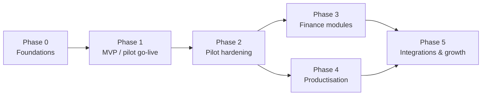

# 10 — MVP Scope and Future Development Roadmap

Status: v0.3 · 6 November 2026 — implementation follows the 15-stage plan in §5 — MVP updated from the owner's answers (doc 12)

Phases are ordered by dependency and business value. **No calendar dates are given**: durations depend on team size, availability of the pilot business for discovery and testing, and answers to the open questions. Indicative relative effort is shown as S / M / L / XL.

---

## 1. MVP definition (v0.2 — updated with the owner's answers)

> The MVP is the smallest system the pilot shop can run on every day — selling (cash, transfer, card and on credit), receiving and controlling stock — with every stock change traceable, cash accountable, and data isolated so a second business could be added safely.

### 1.1 In scope

| Area | Included | FR references |
|---|---|---|
| Tenancy | Multi-business data model + RLS; one shop (location) for the pilot; platform-admin creation of businesses | FR-PLT-001…006 |
| Access | Email sign-in, invitations, default roles, manager override | FR-IAM-001,003…007,009 |
| Configuration | Settings, module registry, numbering, payment methods, reason codes, audit of settings | FR-CFG-001…009 |
| Catalogue | Categories, attributes, Size × Colour variants (editable), whole-number units & conversions (piece/pack/carton), barcodes, images, search, archive | FR-CAT-001…010, 014; FR-UOM-001…004, 006 |
| Pricing | One "Standard" price list, owner-set prices per variant and unit, price history, bulk update | FR-PRC-001…007 |
| Inventory | Ledger, levels, weighted average cost, adjustments, damage write-off, stock counts, stock card, low stock, valuation, **opening-stock entry screen**; negative stock allowed with warning | FR-INV-001…007, 009, 010, 012…015 |
| Purchasing | Suppliers, direct goods receipts, purchase returns, last cost | FR-PUR-001…003, 005, 008 |
| Sales / POS | Desktop + mobile POS, scanner + camera, split payments, holds, receipts (print + PDF/share), customer attach, history, reprint, **sales on credit** | FR-SAL-001…013, 015, 016 |
| Customers & credit | Records, quick-add, history, **customer balances, receive payments, statements** | FR-CUS-001…005 |
| Cash | Sessions, float, pay-ins/outs, blind close, variance, end-of-day | FR-CSH-001…006 |
| Reporting | Dashboard, sales, margin, stock, negative stock, cash, customer balances, CSV export | FR-RPT-001…004, 006…008 |
| Audit | Sensitive-action log | FR-AUD-001…003 |
| PWA | Installable, app-shell caching, online/offline indicator | FR-OFF-001, 002, 006 |
| Hosting | Self-hosted Supabase + Next.js with HTTPS, off-site backups, monitoring (doc 04 §16) | NFR-BCK-* |

### 1.2 Still to decide (doc 12 §4)

| Item | Question | Default |
|---|---|---|
| Offline sale queue | Q1 — server location / must the till sell without internet? | Cloud server + offline cash-sale queue |
| Discounts at the till | Q2 | None |
| Correcting a completed sale | Q3 | Owner-only same-day cancel, audited |
| Credit limits, part-payments | Q4 | Optional limit; part-payments allowed |

### 1.3 Explicitly out of MVP

Customer returns, refunds and voids · tax/VAT · batches and expiry · weighed goods · wholesale/multiple price lists, quantity breaks · price changes at the till · stock transfers and multi-shop UI · spreadsheet import (P2) · purchase orders · supplier payables · expenses · accounting · promotions, bundles, loyalty · made-to-measure orders · payment-terminal integration · WhatsApp/SMS · e-commerce · self-service sign-up and billing · custom-role editor · native apps.

### 1.4 MVP acceptance criteria

1. Two test businesses exist on the staging server; automated tests prove neither can read or write the other's data (tables and storage).
2. A cashier on a phone and on a desktop can each complete a 5-line, split-payment sale in ≤ 30 s.
3. For any variant, the stock card's running balance equals `stock_levels.on_hand`; nightly reconciliation reports zero mismatches over a 2-week pilot.
4. A carton received and sold by the piece shows correct stock and cost.
5. Selling more than is in stock shows a warning, completes, and appears on the negative-stock report.
6. A credit sale increases the customer's balance; a later payment reduces it; the statement matches.
7. Changing a price does not change any historic sale or report.
8. Every price change, adjustment, override and credit sale appears in the audit log with user and time.
9. Cash session close shows expected vs counted cash and variance for every session.
10. The full operational e2e suite passes with the Accounting module stub on and off.
11. A backup taken on the production server has been restored to a separate machine and verified.
12. The owner signs off UAT scripts derived from doc 09 workflows.

## 2. Roadmap

### Phase 0 — Foundations (M)

- Answer remaining questions (doc 12 §4); approve ADRs.
- Provision the self-hosted server(s): Docker, Supabase stack, reverse proxy + HTTPS, SMTP, off-site backups, monitoring; staging and production.
- Repository, CI/CD, environments (local / staging / production), error tracking.
- Spikes: PWA library + iOS/Android install; camera barcode scanning on target phones; thermal printing via browser; IndexedDB outbox prototype; latency to candidate Supabase regions; `btree_gist` uuid support.
- Core schema: tenancy, IAM, config, audit, events, RLS helpers; pgTAP isolation tests.
- Design system: tokens, shadcn/ui theme, layout shell, business switcher, i18n scaffolding.

**Exit:** two businesses isolated in staging; sign-in/invite works; CI green; spike findings recorded as ADRs.

### Phase 1 — MVP / pilot go-live (XL)

Order: catalogue & units → pricing → inventory ledger & posting functions → suppliers & goods receipts → cash sessions → POS & sales → customer credit & payments → stock counts & adjustments → reports & dashboard → UAT → first-time setup with the owner (W20) → go-live with support.

**Exit:** acceptance criteria §1.4 met; pilot trading on the system for 2 consecutive weeks without paper fallback.

### Phase 2 — Pilot hardening (L)

- Offline POS (if not in MVP), sync-conflict review screen.
- Purchase orders; exchanges; customer & supplier import; full data export.
- Custom roles UI; 2FA for owners; support sessions for platform admins.
- In-app notifications and daily email summary.
- Performance tuning from real usage; feedback-driven UX changes.
- Items confirmed later from open questions (e.g. credit sales, batches, wholesale).

### Phase 3 — Finance modules (L)

- **Expenses** module (FR-EXP-*), simple profit report.
- **Accounting** module (FR-ACC-*): chart of accounts template reviewed by a Nigerian accountant, mappings, event consumer, fiscal periods, trial balance, P&L, balance sheet, opening balances, back-posting.
- Receivables/payables if not already built.

### Phase 4 — Productisation for other retailers (L)

- Business templates library (e.g. fashion boutique, mini-mart, electronics, cosmetics).
- Self-service sign-up, onboarding wizard, subscription plans and billing (Q-P01), plan-based module limits.
- Tenant-level usage metering; platform admin console.
- Documentation and help centre; additional UI languages (Q-U04).

### Phase 5 — Integrations and growth (XL, pick by demand)

- Payment terminal / gateway confirmations (Q-S07).
- WhatsApp/SMS receipts and notifications.
- E-commerce/social-commerce catalogue sync.
- Promotions, bundles/kits, loyalty.
- Serial-number tracking, made-to-measure orders (Q-C05), scales.
- Accounting software export; public API and webhooks.
- Advanced analytics (sales forecasting, reorder suggestions).

## 3. Indicative MVP work breakdown

| Work package | Effort |
|---|---|
| Tenancy, IAM, RLS, settings, audit, events | M |
| Catalogue (categories, attributes, variants, units, barcodes, images) | L |
| Pricing (lists, effective dating, bulk update) | M |
| Inventory engine (ledger, levels, costing, posting functions, reconciliation) | L |
| Adjustments, transfers, counts | M |
| Suppliers, goods receipts, purchase returns | M |
| POS (desktop + mobile, scanner, camera, payments, receipts, holds) | L |
| Customer credit, balances, payments | M |
| Cash sessions & end-of-day | S–M |
| Reports & dashboard | M |
| Opening-stock entry & first-time setup | S |
| Self-hosted infrastructure, backups, restore test | M |
| PWA shell, responsive layouts | S–M |
| Testing (pgTAP, unit, e2e, UAT support) | L (continuous) |
| Offline POS (if included) | L |

## 4. Release and support model (to agree)

- Staging releases weekly during Phase 1; production releases after UAT sign-off.
- Hot-fix path for production issues affecting sales.
- Who provides first-line support to the pilot's staff, and in which hours, is undecided (Q-B04).

## 5. Implementation stages (adopted from the Prompt Collection, v0.3)

Each stage ends with: tests passing, a completion report (changes, tests and results, known limitations, acceptance status), and doc updates. The next stage starts only after your approval.

| Stage | Scope | Pilot notes | Phase |
|---|---|---|---|
| 1 | Analysis & documentation | **This pack (v0.3)** — awaiting approval | 0 |
| 2 | Project initialization & foundation | + self-hosted Docker Compose (local & server) | 0 |
| 3 | Database foundation & multi-tenant security | Two-business isolation tests must pass | 0 |
| 4 | Authentication & business accounts | Email sign-in; SMTP on the server | 1 |
| 5 | Sections & categories | e.g. Groceries, Frozen Food, Beverages, Islamic Wear, Clothing & Accessories | 1 |
| 6 | Products, variants, units, prices | Size × Colour; whole-number units; owner-set prices | 1 |
| 7 | Core inventory | Negative stock allowed with warning; opening stock entry | 1 |
| 8 | Dashboard & notifications | Section filter; no expiry alerts in use | 1 |
| 9 | Sales / POS (optional module) | No discounts/price edits; owner same-day cancellation; returns off | 1 |
| 10 | Purchases & suppliers | Direct receiving; supplier optional | 1 |
| 11 | Customers & credit | Optional limits, part-payments, due dates | 1 |
| 12 | Expenses & accounting | Built, off for pilot | 3 |
| 13 | Reports & analytics | Per enabled modules | 1 (core) / 3 |
| 14 | Responsive & PWA | Installable; online/offline indicator; no offline queue | 1 |
| 15 | System testing, security review, deployment | VPS deployment, backups, restore test | 1 |

**Pilot go-live** = Stages 1–11, 13 (core + sales/purchase/credit reports), 14, 15. Stage 12 can follow after go-live.
