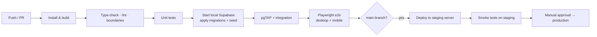

# 13 — Testing Strategy

Status: v0.3 · 6 November 2026

The goal is to prove three things before anyone relies on the system: **data never leaks between businesses**, **stock and money are always correct**, and **the shop can actually use it on its devices**.

---

## 1. Test levels and tools

| Level | What it checks | Tool | Runs |
|---|---|---|---|
| Static | Types, lint rules, import boundaries (core must not import optional modules) | TypeScript `--strict`, ESLint (+ boundaries plugin), Prettier | Every commit (CI) |
| Unit | Pure logic: unit conversion, price resolution, totals, rounding, weighted average cost, permission helpers, Zod schemas | Vitest | Every commit |
| Database | RLS isolation, constraints, triggers, posting functions, stock balances, `balance_before/after`, idempotency, module gating | pgTAP against a local Supabase (Docker) | Every commit |
| Integration | Server actions → database with real auth sessions for different users/roles | Vitest + local Supabase | Every commit |
| End-to-end | Real browser flows on desktop and mobile viewports | Playwright (Chromium desktop + Pixel-size viewport; WebKit for iOS smoke) | Every PR; full suite nightly |
| Concurrency | Parallel sales/adjustments on the same variant | pgTAP / scripted parallel RPC calls | Stage 7 & 9 gates, nightly |
| Manual device | Install PWA, camera scan, receipt print, shop lighting, slow network | Checklist on real Android phone + POS PC | Stage 14 & 15 gates |
| Performance | Response budgets in NFR-PRF | Playwright traces, `k6` for RPC load | Stage 15 |
| Restore drill | Backup → restore to separate machine → verify counts | Scripted | Before go-live, quarterly |

## 2. Test data

- **Two seeded businesses** ("Shop A", "Shop B") with an owner and an attendant each, plus one user who belongs to both — used by every isolation test.
- Pilot-like catalogue fixtures: sections Groceries / Frozen Food / Beverages / Islamic Wear / Clothing & Accessories; a product with carton = 24 pieces; a Jalab with Size × Colour variants.
- Deterministic factories; no production data ever used in tests.

## 3. Critical scenarios (must pass before the related stage is accepted)

### 3.1 Isolation and authorization (Stage 3 onwards)
1. User of Business A cannot select, insert, update or delete any row of Business B — for **every** tenant table (generated test per table).
2. Changing a business ID or record ID in a request does not grant access.
3. Composite FKs reject a product in A pointing to a category in B.
4. Attendant without `pricing.price.update` cannot change a price via UI, server action or direct API call.
5. Storage: A cannot read B's images.
6. Disabled module: route returns "not available", server action rejected, RLS write blocked; data still readable by permitted users.

### 3.2 Inventory integrity (Stage 7)
1. Every stock change writes exactly one movement per line with correct `balance_before`, `balance_after`.
2. `stock_levels.on_hand = SUM(movements)` for all variants after a randomized sequence of 1,000 operations.
3. Carton → piece conversion on receive and sale.
4. Negative stock: allowed with warning flag (pilot setting); blocked when setting is off.
5. 20 parallel deductions on one variant produce the correct final balance and no lost updates.
6. Movements cannot be updated or deleted by any role.
7. Stock count posts only variances, at average cost.

### 3.3 Sales (Stage 9)
1. Completing a sale creates sale, lines, payments, movements and event atomically; a forced failure mid-way leaves nothing behind.
2. Double-submit with the same `client_ref` creates one sale.
3. Historic sale keeps its price after a price change.
4. Split payment totals; cash change.
5. Owner same-day cancellation reverses stock and payments; attendant cannot cancel; cancellation next day refused.
6. Returns refused when `returns_enabled = false`.
7. Sales module disabled → inventory still fully usable.

### 3.4 Purchases (Stage 10)
Receiving increases stock once (retry-safe); draft does not move stock; weighted average cost correct; corrections by reversal only.

### 3.5 Credit (Stage 11)
Credit sale increases balance; part-payment reduces it; duplicate payment (`client_ref`) ignored; credit limit warning; disabling Sales/Customers refused while Credit on.

### 3.6 Dashboard & reports (Stages 8, 13)
Every figure equals a direct SQL computation on the same seed data; section filter changes figures correctly; no sales figures when Sales is off.

## 4. Stage gates

A stage is accepted only when:
1. CI is green (static, unit, database, integration, e2e for that stage).
2. Its critical scenarios in §3 pass.
3. A completion report lists changes, tests and results, known limitations and acceptance status.
4. Docs are updated.

## 5. CI pipeline

## 6. Defects

Severity 1 (data leak, wrong stock/money, cannot sell) blocks release and is fixed first with a regression test. Every bug fix adds a test that fails before the fix.
