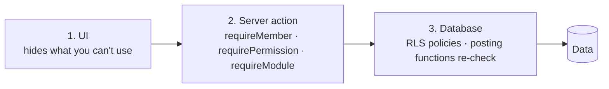

# 14 — Security Model

Status: v0.3 · 6 November 2026

Plain-English summary: **the database itself decides who can see and change what.** The screens hide things for convenience, the server double-checks, and PostgreSQL Row-Level Security makes it impossible to read another business's data even if the app has a bug.

---

## 1. Assets to protect

| Asset | Why it matters |
|---|---|
| Each business's data (products, prices, costs, stock, sales, customers, debts) | Confidential and commercially sensitive; must never leak between businesses |
| Stock and money ledgers | Must be correct and tamper-evident |
| Customer and staff personal data | Data protection obligations (doc 03 NFR-PRV) |
| Credentials and server secrets | Compromise = full access |
| Backups | Contain everything |

## 2. Threats considered

| Threat | Example | Main controls |
|---|---|---|
| Cross-tenant access | User changes an ID in a request to view another shop | RLS on every table, membership checks, composite FKs, isolation tests |
| Privilege escalation inside a business | Attendant changes prices or cancels sales | Permission checks in server actions **and** RLS/posting functions |
| Insider fraud | Unrecorded discounts, fake cancellations, stock write-offs | No till discounts/price edits; owner-only cancellation; reason codes; audit log; stock counts; cash-up variance |
| Ledger tampering | Editing a past movement to hide a loss | Append-only tables; no UPDATE/DELETE privileges; reversals only |
| Duplicate processing | Double-tap creates two sales | Idempotency keys (`client_ref`) with unique constraints |
| Stolen session / device | Phone left logged in | Session expiry, sign-out clears local data, owner can suspend member instantly |
| Leaked secret | Service-role key in browser bundle | Server-only env vars; build check that fails if the key appears in client output |
| Injection / malicious input | SQL injection, oversized uploads | Parameterised queries via Supabase client/RPC, Zod validation, upload type/size limits |
| Server compromise (self-hosted) | Unpatched OS, exposed database port | Hardening checklist §7 |
| Data loss | Disk failure, ransomware | Off-site WAL backups, restore drills |

## 3. Identity

- Supabase Auth (self-hosted GoTrue): email + password; email verification on; password reset via SMTP.
- Passwords ≥ 10 characters; sign-in rate limiting.
- Sessions in secure, HTTP-only cookies (Supabase SSR helpers). No tokens in `localStorage`.
- 2FA for owners and platform admins: Stage 15+ (P2).

## 4. Authorization — three layers

The decision rule (doc 08 §1): active membership **and** role grants the permission **and** module enabled **and** (if location-bound) location access.

- **Owner** role: all permissions, cannot be removed if last owner.
- **Attendant** role (default staff): POS, stock receiving/counting; no cost prices, no price changes, no cancellations; editable by owner.
- **Platform staff**: no implicit tenant access; audited, time-limited support sessions only.

## 5. Database security rules

1. RLS **enabled on every table in `public`**; a migration lint fails if a new table lacks RLS or policies.
2. The `anon` role has no table access.
3. Ledger tables (`stock_movements`, `customer_account_entries`, journals, `audit_logs`, `business_events`): `SELECT` only for `authenticated`; writes only through `SECURITY DEFINER` functions with `search_path = ''`.
4. Every posting function verifies: caller membership, permission, module enabled, and that every referenced ID belongs to the same business.
5. Composite foreign keys `(business_id, id)` prevent cross-business references.
6. The service-role key is used only in a small, reviewed server module (e.g. invitations, platform admin), never for normal user requests.

## 6. Data protection

- Minimal personal data (customer name, phone, optional email/address).
- Customer anonymisation keeps transaction history but removes personal fields.
- Cost prices hidden from users without `inventory.cost.view`, in the API as well as the UI.
- Logs and error reports exclude personal data and secrets.
- Legal review of obligations recommended before go-live (Q-L01).

## 7. Self-hosted server hardening

| Area | Rule |
|---|---|
| Access | SSH keys only, no root login, firewall allows 22 (restricted), 80, 443 only |
| Exposure | Postgres, Studio, Kong admin bound to localhost or VPN — never public |
| Secrets | Replace all Supabase example secrets (JWT secret, anon/service keys, DB password, dashboard password) before first start; stored in `.env` with `600` permissions, outside git |
| TLS | Caddy with automatic certificates; HSTS on |
| Updates | Unattended OS security updates; container images pinned, upgraded via staging |
| Headers | CSP, X-Frame-Options/`frame-ancestors`, Referrer-Policy, Permissions-Policy (camera only for POS) |
| Backups | Encrypted, off-site, 30-day retention, quarterly restore drill |
| Monitoring | Uptime, disk, failed-login spikes, backup success |

## 8. Audit

Logged with actor, time, before/after: sign-ins, member/role/permission changes, module enable/disable, settings, price changes, stock adjustments and counts, cancellations, credit sales and repayments, data exports, platform support sessions. Audit log is append-only and visible to the owner.

## 9. Security acceptance (Stage 15)

- All isolation and authorization tests (doc 13 §3.1) pass.
- No secret present in client bundles or repository history.
- Hardening checklist §7 verified on the production server.
- Restore drill completed.
- Dependency scan: no known critical vulnerabilities.
